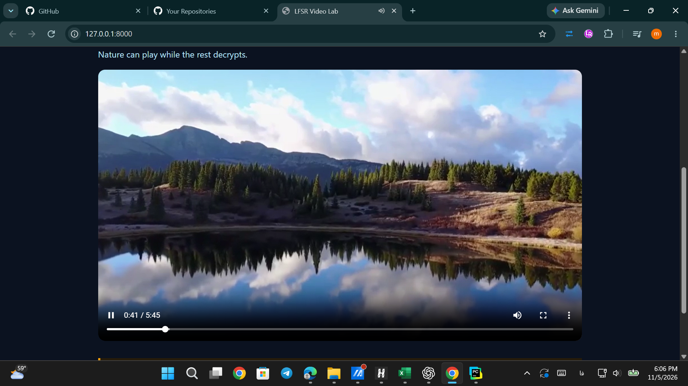
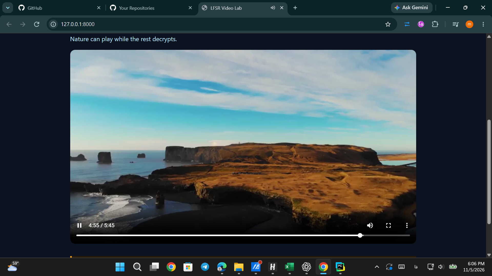

# طراحی و بررسی درستی پیاده‌سازی

هدف، تکمیل مولد جریان کلید و XOR برای پخش قطعه‌ای ویدئو است. هر هشت تابع خواسته‌شده تکمیل شده‌اند؛ سرور، پروتکل انتقال، رابط کاربری و Service Worker آمادهٔ پروژه تغییر نکرده‌اند.

ثبات خطی و قرارداد ترتیب بیت‌ها

حالت یک عدد ۱۶ بیتی است. خروجی هر گام، بیت صفر حالت است. بیت‌های صفر، دو، سه و پنج با XOR ترکیب می‌شوند؛ ثبات یک خانه به راست می‌رود و بیت بازخورد در جایگاه ۱۵ قرار می‌گیرد. این قرارداد متناظر با چندجمله‌ای صورت سؤال است.

`f = (s ^ (s >> 2) ^ (s >> 3) ^ (s >> 5)) & 1`

`output = s & 1;  next_state = (s >> 1) | (f << 15)`

برای آفست بایتی، هشت برابر آفست گام طی می‌شود. در LFSR، شمار گام‌ها پیمانهٔ ۶۵۵۳۵ کاهش می‌یابد. نخستین بیت تولیدشده در پرارزش‌ترین جایگاه بایت می‌نشیند. رمزکردن و رمزگشایی هر دو XOR داده با جریان کلید متناظر هستند.

دو مولد غیرخطی

در NLFSR، حاصل AND بیت‌های یک و هفت به بازخورد پایه XOR می‌شود. دورهٔ LFSR برای این مولد فرض نشده و آفست دقیقاً طی می‌شود. در گفه، سه ثبات مستقل گام می‌خورند و خروجی‌های x و y و z با رابطهٔ زیر ترکیب می‌شوند:

`g(x,y,z) = (x & y) ^ ((1 ^ x) & z)`

نتایج بررسی درستی

هر ۲۰ آزمون اولیه پاس شد؛ خروجی کامل در فایل tests ذخیره شده است. آزمون‌ها بردارهای معلوم، تقارن XOR، آفست‌ها، ورودی نامعتبر، API و قرارداد مرورگر را پوشش می‌دهند. در بررسی تکمیلی، ۶۳ حالت میان پایتون و جاوااسکریپت، شامل مرزهای دوره و آفست بزرگ، برابر بودند و XOR جاوااسکریپت در همهٔ آن‌ها وارون خودش بود.

`LFSR:  87 35 44 e2     (seed = 0xACE1)`

`NLFSR: 87 35 4e c1 db 72 b3 3a`

`Geffe: af 7d 76 c4 bb 0a 17 b4`

فایل واقعی nature.mp4 با 33,274,101 بایت، از مسیر API سرور قطعه‌قطعه رمز شد و با همان تابع جاوااسکریپت مورد استفادهٔ مرورگر رمزگشایی شد؛ تمام بایت‌ها و SHA-256 با اصل برابر بود. تصاویر صفحهٔ چهارم نیز پخش ویدئو در مرورگر را در دو موقعیت زمانی نشان می‌دهند.

# نتایج کارایی و آزمون‌های آماری

اجرای پیش‌فرض ابزار ارزیابی با 131,072 بایت، معادل 1,048,576 بیت، انجام شد. اندازهٔ قطعه 65,536 بایت و بیت‌ریت مرجع 2 Mbps بود. محیط اجرا: Windows، Python 3.12.4، Flask 3.1.0، NistRng 1.2.3، NumPy 2.5.4 و SciPy 1.18.1.

میانگین تأخیر هر قطعه 267.80 میلی‌ثانیه و نرخ رمزکردن 1.958 Mbps است. نسبت سرعت به بیت‌ریت مرجع 0.979 است؛ کمتر از یک و بدون حاشیهٔ کافی برای پخش پیوستهٔ ۲ مگابیتی. بافر می‌تواند شروع پخش را ممکن کند، اما این اندازه‌گیری تضمین پخش بلادرنگ نیست. هزینهٔ شبکه، دیسک و رمزگشایی مرورگر هم در این معیار نیامده است.

سرعت تولید صرف جریان کلید در مقایسهٔ مولدها: LFSR: 2.420 Mbps؛ NLFSR: 2.282 Mbps؛ GEFFE: 0.662 Mbps. گفه سه ثبات را به‌روزرسانی می‌کند و در این اجرا کندتر است. این اعداد یک نمونهٔ زمان‌گیری روی این دستگاه‌اند.

جدول وضعیت گزارش‌شده توسط NistRng

| Test | LFSR | NLFSR | Geffe |
|---|---|---|---|
| monobit | قبول | قبول | قبول |
| frequency_within_block | قبول | قبول | قبول |
| runs | قبول | قبول | قبول |
| longest_run_ones_in_a_block | قبول | رد | رد |
| binary_matrix_rank | رد | قبول | قبول |
| dft | رد | رد | رد |
| non_overlapping_template_matching | قبول | قبول | قبول |
| overlapping_template_matching | رد | رد | رد |
| maurers_universal | قبول | رد | رد |
| linear_complexity | رد | رد | رد |
| serial | رد | رد | رد |
| approximate_entropy | رد | رد | رد |
| cumulative sums | رد | رد | رد |
| random_excursion | رد | رد | رد |
| random_excursion_variant | رد | رد | رد |
در این نمونه، LFSR شش آزمون را قبول و نه آزمون را رد کرد؛ NLFSR و گفه هرکدام پنج قبولی و ده رد داشتند. ابزار هیچ آزمونی را غیرقابل اجرا اعلام نکرد. بهبود رتبهٔ ماتریس در دو مولد غیرخطی با قبولی همهٔ آزمون‌ها همراه نشده است.

جدول عین وضعیت passed/failed کتابخانه است؛ score در آزمون‌های چندخروجی میانگین است و برای بازسازی وضعیت کافی نیست. آزمون الگوی غیرهم‌پوشان در این کتابخانه الگو را تصادفی برمی‌گزیند، پس امتیاز آن بین اجراها و بین دو بخش LFSR یکسان نخواهد بود. همهٔ مقادیر و زمان‌ها در JSON کامل آمده‌اند. این خروجی گواهی رسمی NIST یا ارزیابی چندنمونه‌ای مولد نیست.

# تحلیل امنیتی و وضعیت تحویل

خطی‌بودن، دوره و فضای حالت

LFSR شانزده‌بیتی فقط ۶۵۵۳۵ حالت مجاز دارد. با معلوم‌بودن رابطهٔ بازخورد، ۱۶ بیت خروجیِ متوالی برای بازسازی حالت کافی است؛ اگر رابطه نامعلوم باشد، روش برلکمپ-مسی از تقریباً دو برابر طول ثبات خروجی، رابطهٔ خطی را بازیابی می‌کند. تعادل تعداد صفر و یک و حتی قبولی آزمون‌های آماری مانع پیش‌بینی خروجی نمی‌شود. [۱،۲]

پیمایش مستقیم حالت‌ها برای seed برابر 0xACE1، دورهٔ LFSR را 65,535 بیت و دورهٔ NLFSR را 42,675 بیت نشان داد؛ در هر دو، گذرای اولیه صفر بود. پس افزودن جملهٔ AND در این نمونه دوره را کوتاه‌تر کرد. دورهٔ NLFSR به seed وابسته است و غیرخطی‌بودن، فضای ۱۶ بیتی را بزرگ نمی‌کند. آفست بایتی 65,535 این مولد نیز جداگانه با شبیه‌سازی مستقیم تطبیق داده شد.

ضعف ترکیب گفه

اگر x صفر باشد، خروجی گفه z و اگر یک باشد، خروجی y است. برای ورودی‌های مستقل و متعادل، احتمال برابری خروجی با y یا z برابر ۳/۴ می‌شود؛ مهاجم می‌تواند seed هر ثبات را با سنجش هم‌بستگی حدس بزند. در نمونهٔ پیش‌فرض، نسبت تطابق اندازه‌گیری‌شده با هر دو خروجی حدود 0.749996 بود. [۲]

در همین پروژه هر سه ثبات طول و چندجمله‌ای یکسان دارند؛ حالت مشترک پس از 65,535 گام تکرار می‌شود، بنابراین دورهٔ خروجی گفه حداکثر همین مقدار است. نباید مزیت دورهٔ ترکیب ثبات‌های با طول‌های نسبت‌به‌هم‌اول را برای این نمونه فرض کرد.

استفادهٔ مجدد از جریان کلید

اگر دو پیام با seed و آفست یکسان رمز شوند، XOR متن‌های رمزشده برابر XOR متن‌های اصلی خواهد بود. معلوم‌بودن بخشی از یکی از پیام‌ها، بخش متناظر پیام دیگر را آشکار می‌کند. دورهٔ کوتاه همین خطر را داخل یک فایل هم ایجاد می‌کند. علاوه بر آن، seed در API آموزشی آشکار است و XOR به‌تنهایی اصالت و تمامیت داده را تأمین نمی‌کند.

`C1 XOR C2 = P1 XOR P2;   P2 = C1 XOR C2 XOR P1`

اجرا، مخزن و اقلام باقی‌مانده

کد تکمیل‌شده، خروجی ۲۰ تست، JSON ارزیابی کامل و بررسی تکمیلی آماده‌اند. وابستگی‌ها در مفسر فعلی PyCharm نصب شده‌اند و Run Configuration سرور اضافه شده است. مخزن محلی به Fork زیر وصل شده؛ تغییرهای جدید هنوز Commit یا Push نشده‌اند:

`https://github.com/Mahdi-Arjmandnia/secure_video_steam`

تصاویر پخش ارائه‌شده در صفحهٔ چهارم آمده‌اند و در پوشهٔ تحویل نیز ذخیره شده‌اند. گزارش عملی باید به انتهای پاسخ تئوری پیوست شود؛ فایل پاسخ تئوری در اختیار نبود. نسخهٔ نهایی پروژه باید به Fork فرستاده شود و فایل‌های با پیشوند شماره دانشجویی در کوئرا ارسال شوند.

منابع: [۱] NIST SP 800-22 Rev.1a، آزمون آماری جایگزین تحلیل رمز نیست. [۲] Handbook of Applied Cryptography، فصل ۶، بخش‌های LFSR و حملهٔ هم‌بستگی گفه.

`https://csrc.nist.gov/pubs/sp/800/22/r1/upd1/final`

`https://cacr.uwaterloo.ca/hac/about/chap6.pdf`

# تصاویر اجرای برنامه در مرورگر

سرور محلی از طریق اجرای Video server در PyCharm در دسترس است. تصاویر زیر توسط دانشجو از صفحهٔ Chrome ارائه شده‌اند؛ آدرس محلی، تصویر ویدئو و زمان غیرصفر همراه با نماد توقف موقت دیده می‌شود.

تصویر ۱: پخش Nature در زمان ۰:۴۱ از مجموع ۵:۴۵.

تصویر ۲: پخش همان ویدئو در موقعیت ۴:۵۵ از مجموع ۵:۴۵.

این تصاویر شاهد اجرای دیداری در دو موقعیت ویدئو هستند. آن‌ها به‌تنهایی زمان شروع پخش، میزان بافر یا دریافت هم‌زمان قطعه‌ها را اندازه‌گیری نمی‌کنند؛ معیار کارایی همان سنجش صفحهٔ دوم است.
